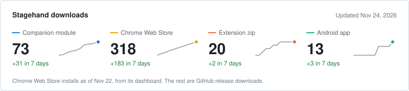
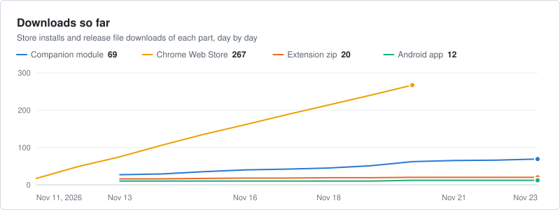
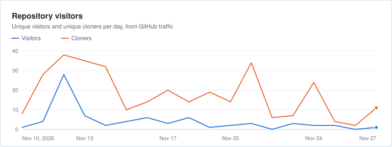

# Stagehand download counts

Written once a day by the Download counts workflow (`.github/workflows/stats.yml` on `main`). Last snapshot: Nov 28, 2026. Do not edit by hand: the next run replaces this file and the charts.

<picture>
  <source media="(prefers-color-scheme: dark)" srcset="https://raw.githubusercontent.com/Affid/stagehand/stats/card-dark.svg">
  
</picture>

<picture>
  <source media="(prefers-color-scheme: dark)" srcset="https://raw.githubusercontent.com/Affid/stagehand/stats/downloads-dark.svg">
  
</picture>

<picture>
  <source media="(prefers-color-scheme: dark)" srcset="https://raw.githubusercontent.com/Affid/stagehand/stats/traffic-dark.svg">
  
</picture>

## Totals

| | Downloads so far | What it counts |
| --- | ---: | --- |
| Chrome Web Store | 318 | Installs from the store, summed from the daily counts in its Developer Dashboard exports (`chrome-web-store/`). Last export day: Nov 22, 2026. |
| Companion module | 86 | `stagehand.zip` downloads: the companion module installed or updated by Foundry. |
| Extension zip | 21 | The extension's zip from the releases, for people who load it unpacked. |
| Android app | 15 | The APK from the releases, sideloaded. |
| Foundry lookups | 513 | `module.json` downloads: Foundry reading the release manifest through the foundryvtt.com listing. These are lookups, not installs. |

Every release file

| Release | File | Downloads |
| --- | --- | ---: |
| stagehand-v0.2.0 | module.json | 273 |
| stagehand-v0.2.0 | stagehand.zip | 35 |
| stagehand-v0.1.2 | module.json | 229 |
| stagehand-v0.1.2 | stagehand.zip | 44 |
| stagehand-v0.1.1 | module.json | 5 |
| stagehand-v0.1.1 | stagehand.zip | 2 |
| stagehand-v0.1.0 | module.json | 6 |
| stagehand-v0.1.0 | stagehand.zip | 5 |
| stagehand-extension-v0.4.0 | stagehand-extension-0.4.0.zip | 1 |
| stagehand-extension-v0.3.3 | stagehand-extension-0.3.3.zip | 1 |
| stagehand-extension-v0.3.2 | stagehand-extension-0.3.2.zip | 6 |
| stagehand-extension-v0.3.1 | stagehand-extension-0.3.1.zip | 5 |
| stagehand-extension-v0.3.0 | stagehand-extension-0.3.0.zip | 4 |
| stagehand-extension-v0.2.1 | stagehand-extension-0.2.1.zip | 1 |
| stagehand-extension-v0.2.0 | stagehand-extension-0.2.0.zip | 3 |
| stagehand-app-v0.4.0 | stagehand-0.4.0.apk | 1 |
| stagehand-app-v0.3.3 | stagehand-0.3.3.apk | 3 |
| stagehand-app-v0.3.2 | stagehand-0.3.2.apk | 3 |
| stagehand-app-v0.3.1 | stagehand-0.3.1.apk | 2 |
| stagehand-app-v0.3.0 | stagehand-0.3.0.apk | 2 |
| stagehand-app-v0.2.1 | stagehand-0.2.1.apk | 1 |
| stagehand-app-v0.2.0 | stagehand-0.2.0.apk | 3 |

## Data

- [`downloads.csv`](downloads.csv): every release file's total, once a day. The difference between two days is that day's downloads.
- [`traffic.csv`](traffic.csv): GitHub's views and clones per day, with unique visitors. GitHub keeps only 14 days; this keeps them all. Referrers are not saved: they name people's own Foundry servers.
- [`chrome-web-store/`](chrome-web-store): CSV exports of daily installs from the Chrome Web Store Developer Dashboard (Analytics, Installs, Export), uploaded by hand; the store has no API for them. To add one, open that folder on GitHub, choose Add file, Upload files, and commit to `stats`. The next daily run counts it, or run the Download counts workflow by hand. Exports may overlap; each day keeps its highest count.
