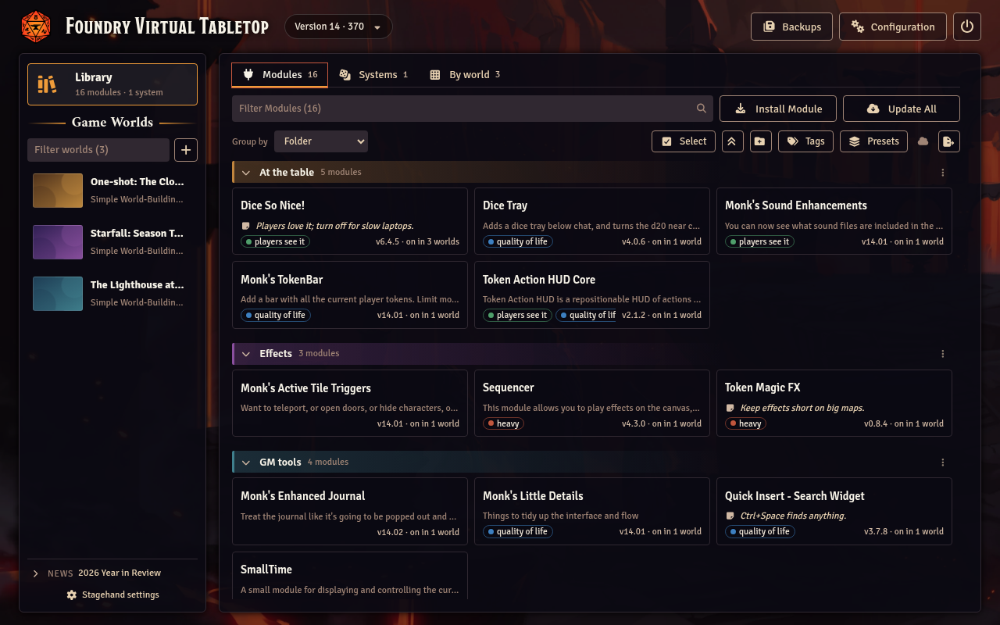
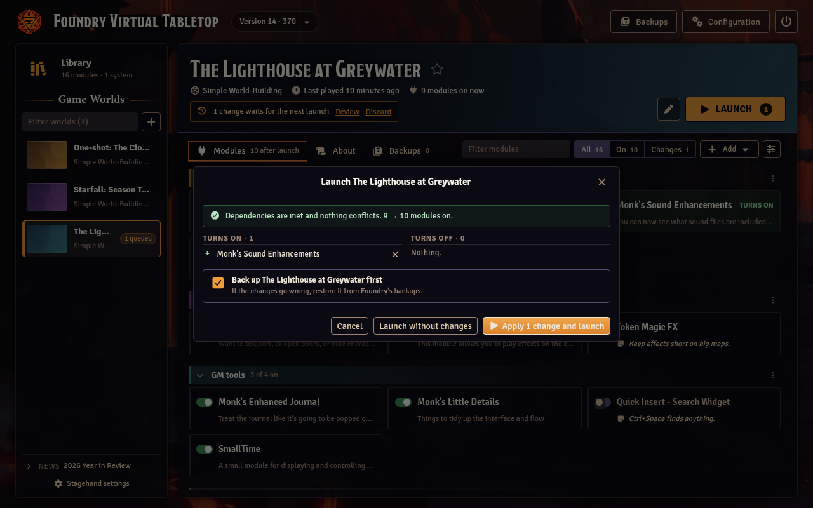
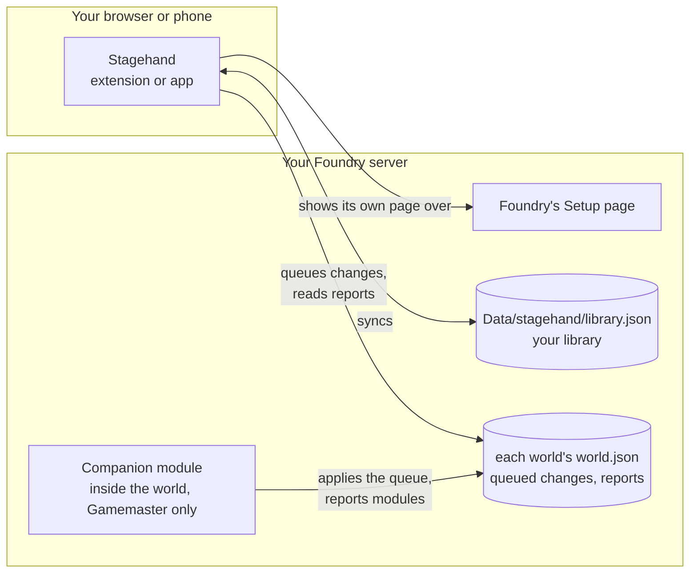

<p align="center">
  
</p>

# Stagehand for Foundry VTT

Stagehand replaces Foundry VTT's Setup screen with a calmer one built
around your modules: a library with folders, tags and notes, presets you
can apply to any world, a view of which modules each world uses, and
queued module changes you review before they happen. It also covers the
rest of Setup: launching worlds, backups, configuration and Foundry's own
updates.

Stagehand is not affiliated with or endorsed by Foundry Gaming LLC.

https://github.com/user-attachments/assets/95aa1de2-6b0b-400c-8874-ff722e6487b8





## Parts

- **Browser extension** (Chrome; Firefox add-on built from the same code):
  the new Setup page, shown on the servers you allow it on.
- **Android app**: the same Setup page on a phone or tablet, for servers you
  add in the app.
- **Companion module** (`stagehand`): runs inside a world for the full
  Gamemaster only. It reports the world's modules to Setup and applies the
  changes you queued, after showing them in a dialog. On its own it does
  nothing; it needs the extension or the app.

How they fit together. Everything stays on your device and your own
Foundry server:



Status: public release (companion 0.1.2, extension and app 0.3.2).
Foundry VTT 13 and 14.

## Install

- Companion module: Stagehand offers to install it on a server that
  doesn't have it (see First run). By hand: in Foundry's Install Module
  window, search for **Stagehand** (it is in Foundry's package list), or
  paste the manifest URL
  `https://raw.githubusercontent.com/Affid/stagehand/manifests/stagehand/module.json`.
- Extension: install
  [Stagehand for Foundry VTT](https://chromewebstore.google.com/detail/iilpkngpgiiocbmnnjkhmehaadnpknac)
  from the Chrome Web Store. To load it by hand instead, download the zip
  from the [releases](https://github.com/Affid/stagehand/releases) and
  load it unpacked (`chrome://extensions`, Developer mode, Load unpacked).
- Android app: the APK from the
  [releases](https://github.com/Affid/stagehand/releases), sideloaded.

## First run

Installing the extension changes nothing by itself: Stagehand only works on
the Foundry servers you turn it on for.

1. Open your Foundry server in the browser and log in to Setup as the
   administrator.
2. Click Stagehand's toolbar button (under Chrome's puzzle-piece menu until
   you pin it), choose **Use Stagehand here** and allow the site when Chrome
   asks. The page reloads as Stagehand's Setup. In the Android app, add the
   server's address on the home screen instead.
3. If the companion module isn't on the server yet, Stagehand says so at
   the top of the Library and on each world's page. Press **Install**: it
   runs Foundry's own installer with the manifest URL above.
4. Once for each world: launch it, open Manage Modules, turn on
   **Stagehand** and save. Back on Setup, the world's modules show up,
   ready to change. Until then the Library, presets, backups, configuration
   and updates all work; only that world's module list is missing.

To get Foundry's own Setup back, remove the server under Stagehand
settings (the same toolbar button, or the link at the foot of the world
list). Its library stays in the browser for when you add the server again,
and nothing on the server changes.

## Your data

- The library (folders, tags, notes, saved views, presets) is kept in the
  browser or app, and in `Data/stagehand/library.json` on your Foundry
  server so it follows you to every device. Like everything in Foundry's
  Data folder, that file can be read by anyone who knows its path; don't
  put secrets in module notes.
- Queued changes and the companion's reports live in each world's own
  flags (`world.json`).
- Stagehand talks to your Foundry server. Beyond it, the extension and the
  app read their Setup page configuration (selectors and switches, never
  code) from this repository once a day, and, only if you allow it,
  Foundry's release notes on foundryvtt.com. They collect nothing and send
  nothing elsewhere.
- The companion module talks to nothing but your Foundry server.

## License

MIT, see [LICENSE](LICENSE). Design notes and plans are in [docs](docs).

## Development

Requirements: Node 22.18+, pnpm 12, a local Foundry (see below).

```bash
pnpm install
pnpm build            # extension -> packages/extension/dist, module -> packages/module/dist
pnpm test             # unit tests (Vitest)
pnpm test:coverage    # with the 80% threshold
pnpm lint && pnpm typecheck && pnpm format:check
pnpm verify           # all of the above
```

Load the extension unpacked from `packages/extension/dist` (Chrome:
`chrome://extensions`, developer mode). Open your Foundry server, click the
extension's toolbar button and choose Use Stagehand here (or add the
server's address, for example `http://localhost:30000`), then allow the
site. The same panel opens from the Setup page's rail and as the
extension's options.

## Android app

The app (`packages/android`, Kotlin; docs/ANDROID-APP-PLAN.md) shows the
same Setup page in a WebView. It needs JDK 21 in `~/opt/jdk-21*` and the
Android SDK in `~/Android/Sdk` (or `ST_ANDROID_JAVA_HOME` and
`ANDROID_HOME`); see docs/ANDROID-SPIKE.md for the install.

```bash
pnpm android:build    # pnpm build, then the debug and the signed release APK
pnpm android:test     # Kotlin unit tests, with the 80% coverage gate
pnpm test:android     # the app end to end on a device (the emulator by default)
```

`pnpm test:android` needs the emulator (or a phone) on Windows' adb and
the local Foundry on Setup; for a phone, set `ST_ANDROID_SERIAL` and
`ST_APP_SERVER` (the server as the phone reaches it). The APKs land in
`packages/android/app/build/outputs/apk/`. The release
is signed with the key in `~/.config/stagehand/` (outside git; built
unsigned without it). `node scripts/android/contract-vectors.ts` rewrites
the native rules' answers the Kotlin tests check, after a change to
`packages/extension/src/app/native-api.ts` or `native-requests.ts`.

## Local Foundry

Settings come from `.env.local` (copy `.env.example`): Foundry's app and data
folders, port and administrator password.

```bash
pnpm foundry:start    # runs Foundry (V14 Node build) in the foreground
pnpm build && pnpm foundry:link   # links the module and test fixtures into Data/modules
pnpm foundry:setup    # creates the stagehand-test world and its users, safe to repeat
pnpm test:foundry     # end-to-end suites against the running Foundry (~5 minutes)
```

The test world has `Gamemaster` (full GM), `Assistant` (Assistant GM) and
`Player1`, all without passwords. `fixtures/modules` holds three tiny test
modules: a library, a module that requires it, and one that conflicts with it.

### An older build

The Update page's checks against a real newer release
(`tests/foundry/setup-update-older.spec.ts`) run only on an older Foundry
build; on the usual up-to-date server they skip. Stop the usual server, then
run a copy of an older build with a copy of the data, so neither the install
nor the worlds are touched:

```bash
cp -a ~/foundry/vtt-14.369-backup ~/foundry/test-369/vtt
cp -a ~/foundry/data ~/foundry/test-369/data
FOUNDRY_APP_DIR=~/foundry/test-369/vtt FOUNDRY_DATA_DIR=~/foundry/test-369/data \
  FOUNDRY_ALLOW_UPDATE=1 pnpm foundry:start
pnpm test:foundry setup-update-older
```

The tests never press Update. Delete `~/foundry/test-369` afterwards and
start the usual server again.

## Layout

Each package has its own README: [module](packages/module/README.md),
[extension](packages/extension/README.md),
[android](packages/android/README.md), [shared](packages/shared/README.md).

```
packages/shared            protocol, schemas, version logic, resolver, library model and sync
packages/extension         the Setup page, its background and Foundry adapters (Preact)
  src/compat/v13           everything Foundry 13 does differently (docs/FOUNDRY-13-PLAN.md)
  src/app                  the app's side of the same page (native bridge, running page)
packages/module            companion module: session, apply flow, dialog
packages/android           Android app: WebViews, native bridge (Kotlin, Gradle)
config/setup-config.json   Setup adapters read from this repository (pnpm config:write)
scripts/foundry            local Foundry helpers (admin API, world setup, linking)
scripts/android            Gradle wrapper, contract vectors, coverage
scripts/dev, scripts/spike developer and spike helpers
tests/foundry              live suites against a local Foundry (Setup UI, in-world apply)
tests/app                  the app's web part in Playwright, its native side simulated
tests/android              the on-device suite for the Android app
fixtures/modules           three tiny modules the live suites install
design                     mockups the UI follows (Setup page, app screens, icon)
spikes                     throwaway experiments that answered early questions
docs                       product requirements, plans and findings (docs/README.md)
.github/workflows          CI (pnpm verify) and the companion's release
```
