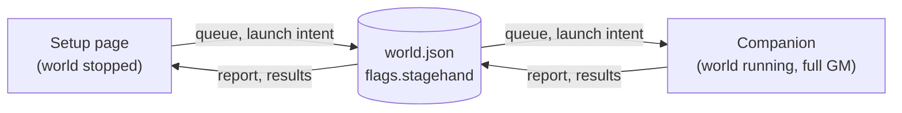

# The companion module: a developer guide

For anyone who works on the companion module (`packages/module`) or
reviews it: what it is for, how to run it, how the code is put together,
and what to keep in mind when changing it. Read it next to the source; the
module is under 800 lines.

## What it is for

Stagehand's Setup page (in the extension or the app) runs while no world
does. It can't see inside a world: which modules are on is kept in the
world's own database, out of Setup's reach. The companion runs inside the
world and does two things:

- **Reports** the world's active modules, with their versions and the
  Foundry and system versions, so Setup can show them.
- **Applies** the module changes queued on Setup, after showing them to the
  Gamemaster, or without asking when the Gamemaster already reviewed that
  exact change on Setup at launch.

Both go through one place: `flags.stagehand` in the world's own
`world.json`. Setup reads and writes it while the world is stopped; the
companion while it runs. There is no other channel between them: no
server, no socket, no messages.



[COMPANION-WORLD-PROTOCOL.md](COMPANION-WORLD-PROTOCOL.md) has the design
and the decisions behind it.

## Running it

Settings for the local Foundry come from `.env.local` (copy
`.env.example`). From the repository root:

```bash
pnpm build                  # the module into packages/module/dist (and the extension)
pnpm foundry:start          # Foundry in the foreground, in another terminal
pnpm foundry:link           # links dist into Data/modules/stagehand
pnpm foundry:setup          # the stagehand-test world, with only the companion on
```

Launch `stagehand-test` and join as `Gamemaster` (no password). The first
join writes `flags.stagehand.report` into the world's `world.json`; later
joins write it again only when something in it changed.
Messages go to the browser console prefixed `Stagehand |`. After a change to
the source, `pnpm build` and reload the world (the link points at `dist`).

To see an apply, queue a change on the Setup page with the extension
loaded, or write a queue into `flags.stagehand` by hand (the format is
below) and join again.

## How the code is put together

The module is TypeScript, bundled with Vite into one unminified ES module,
`dist/stagehand.js`, with the parts of `packages/shared` it imports.

One rule shapes it: **only `index.ts` touches Foundry.** It reads Foundry's
globals (through `foundry.ts`) and hands everything else in as plain
dependencies: the game object, the dialog class, `fetch`, notifications,
reload. Every other file is plain logic over those dependencies, so the
unit tests run it against fakes (`test/fakes.ts`) without Foundry.

| File               | Role                                                                                 |
| ------------------ | ------------------------------------------------------------------------------------ |
| `index.ts`         | Entry point on Foundry's `ready` hook: the first-GM check, then one session          |
| `foundry.ts`       | The few Foundry APIs used, typed narrowly; `MODULE_ID`                               |
| `gamemaster.ts`    | Which Gamemaster runs the session                                                    |
| `world-session.ts` | One join: read the flags, settle the last change, report or apply, save              |
| `apply.ts`         | Plan, ask, record, write the module configuration, reload                            |
| `dialog.ts`        | The confirmation dialog; escapes every value it shows                                |
| `world-state.ts`   | Reads the live world; builds the plan and the module configuration                   |
| `world-io.ts`      | Saves our flags (Foundry's `editWorld`) and reads the server's clock (`/api/status`) |

From `packages/shared`, also used by Setup, so both sides agree:

| File                       | Used for                                                         |
| -------------------------- | ---------------------------------------------------------------- |
| `world-flags.ts`           | The flags' format: schemas, limits, `readStagehand`, `fitReport` |
| `resolver.ts`, `resolver/` | The plan: what turns on and off, requirements, conflicts         |
| `package-read.ts`          | A live Foundry module as plain data, for the resolver            |
| `version.ts`               | Foundry version parsing and compatibility, mirroring core        |
| `world.ts`                 | The queued command type and the flags key                        |
| `log.ts`, `zod-config.ts`  | Console output; Zod without `new Function`                       |

What ships, in `packages/module/dist`: `module.json` and `lang/en.json`
(copied from `static`) and `stagehand.js`.

## The flags

`world.json` → `flags.stagehand`, read field by field by `readStagehand`
(`shared/world-flags.ts`): a field that doesn't pass is left out, never the
rest.

| Field    | Written by | What                                                                                            |
| -------- | ---------- | ----------------------------------------------------------------------------------------------- |
| `v`      | both       | The format's version (`FORMAT`, now 1). A side that sees a newer one leaves it all alone        |
| `queue`  | Setup      | Changes waiting: each with an id, a mode (`replace`, `add`, `remove`), module ids, preset names |
| `launch` | Setup      | The launch's intent: `reviewed` (with the target module set) or `hold`; used once               |
| `report` | companion  | The active modules (`id@version`), versions, the results of each change, the launch it answered |

A result's status moves like this:

- `applying` (with `targetKey`, a short hash of the module set it should
  leave on), recorded before anything changes;
- then, on the next join, `applied` if the active modules match the key,
  or `failed` with a reason if they don't;
- `declined` when the Gamemaster chose Discard;
- `applied` at once when the change turned out to change nothing.

Limits, all in `world-flags.ts`: 50 queued changes, 60 KB of queue, 90 KB
per save (Foundry refuses a request body over 100 KB). A report too big for
one save drops versions first, then modules from the end, and says
`partial: true`.

## One join, step by step

1. **`index.ts`**: on `ready`, `isFirstGamemaster` decides whether this
   user runs the session. If not, nothing happens. Errors are logged, never
   thrown into Foundry.
2. **`gamemaster.ts`**: only a full Gamemaster (role 4) runs it, and of
   those online, only the one whose id sorts first. Two Gamemasters never
   apply the same queue; Assistant GMs never run it (Foundry's world edit
   refuses them anyway).
3. **`world-session.ts`, `runWorldSession`**:
   - Reads the flags. Written by a newer Stagehand: a notice
     (`STAGEHAND.Outdated`), and stop. A queue that doesn't pass: a notice
     (`STAGEHAND.BadQueue`), and it counts as empty.
   - Reads the server's clock (`world-io.ts`, `clock`): the server's `Date`
     header and the world's `uptime`. The launch intent counts only if Setup
     wrote it just before this world started (`launchIsFresh`: up to 10
     minutes before, 5 seconds after) and the last report didn't already
     answer it. Without the clock no intent counts, and the dialog asks.
   - No queue, or the intent says `hold`: `reportOnly` settles earlier
     results and saves the report, only if it changed apart from its time.
   - A queue: `applyQueue` hands it to `apply.ts` with a `record` function
     that saves the results and takes the recorded changes off the queue in
     the same save.
4. **`apply.ts`, `applyCommands`**:
   - `planFor` (`world-state.ts`) plans against the live world with the
     shared resolver: what turns on and off, which requirements come along,
     conflicts, dependents, missing, blocked and incompatible modules.
   - A reviewed launch whose live plan is exactly what was reviewed, with
     no question to ask (`asReviewed`): applies without the dialog and says
     so in a notice.
   - Otherwise **`dialog.ts`, `askGm`**: Apply & reload, Not now, or
     Discard. Conflicts need the box ticked; removing a module others need
     needs the "remove those too" box (`refusal`). Closing the dialog is Not
     now: the queue waits.
   - `write`: records `applying` first. If that save fails, nothing
     changes. Then it writes core's `moduleConfiguration` setting
     (`world-state.ts`, `moduleConfiguration`: every installed module
     listed, the companion always on, entries for modules not installed
     right now kept) and reloads once.
5. **The next join**, after the reload: `settle` turns `applying` into
   `applied` or `failed`, and the report goes out.

`world-io.ts` saves with `POST /setup` `editWorld`, which Foundry allows a
full Gamemaster while the world runs (checked on 13.351 and 14.370). A save
appears in the page's copy of the world only after a reload, so after each
save it also updates that copy (`updateSource`) and calls the
`stagehandSaved` hook. Requests never follow a redirect (a refused one
redirects to the join page) and time out after 15 seconds.

## Rules worth keeping

- **Record before change** (`apply.ts`, `write`). A change made without a
  saved record would be applied again on the next join.
- **The live world wins** (`planFor`). The plan comes from what is
  installed and on now, never from Setup's possibly stale picture.
- **Everything in the flags is untrusted** (`readStagehand`). Setup, a
  Gamemaster of another world, another tool or a hand edit of `world.json`
  could have written it. Every field is checked and bounded.
- **Every shown value is escaped** (`dialog.ts`, `escapeHtml`): module ids,
  preset names, reasons.
- **Saves stay under Foundry's limit** (`MAX_SAVE_BYTES`, `fitReport`).
- **The companion stays on** (`moduleConfiguration` always includes
  `MODULE_ID`), so no change can switch off the thing that reports it.
- **Only the Foundry server.** No other host, no telemetry, no AI at
  runtime.

## Making changes

- **A string.** All of them are in `static/lang/en.json` under
  `STAGEHAND`, read with `game.i18n`. The dialog's are under
  `STAGEHAND.Apply`.
- **A new question in the dialog.** If the resolver's `Plan` grows a new
  kind of problem, add it to the dialog's `sections`, to `refusal` if it
  needs consent, and to `asReviewed`: a reviewed launch must not skip a
  question the Gamemaster never saw.
- **The flags' format.** It lives in `shared/world-flags.ts` and Setup
  reads it too. A new optional field is safe. Anything an older version
  would misread needs `FORMAT` raised; older sides then leave the flags
  alone and say so. Foundry merges a save into the stored object, so the
  report is always saved whole: a field left out keeps its old value.
- **A new Foundry API.** Add the narrowest type to `foundry.ts`, pass it
  in from `index.ts`, and give `test/fakes.ts` a fake. Check it on Foundry
  13 and 14 (`compatibility` in `module.json`: minimum 13).
- **The plan itself** (`shared/resolver.ts`). Setup uses the same resolver
  for its preview, so a change shows on both sides; its tests are in
  `packages/shared/test/resolver.test.ts`.

## Tests

```bash
pnpm test packages/module             # the module's unit tests
pnpm test                             # everything, as CI runs it
pnpm test:foundry apply               # in-world end to end against the local Foundry
pnpm test:foundry companion-http      # the companion on plain http at a network address
```

- `test/apply.test.ts`: world state, the dialog's escaping, every choice
  and refusal, record-before-change.
- `test/world-session.test.ts`: the report, settling, launch intents (fresh,
  leftover, held, already answered), refused saves, Discard, unreadable
  queues.
- `test/world-io.test.ts`: saving, the page copy, redirects and timeouts,
  the size limit, the clock, which Gamemaster runs it.
- `test/manifest.test.ts`: the manifest's URLs, version and compatibility.
- `tests/foundry/apply.spec.ts`: the whole loop on a real Foundry with the
  extension: a reviewed launch, a remove that others need, the Assistant
  GM, Launch without changes, a Gamemaster in a browser without Stagehand.

Coverage must stay at 80% or more (`pnpm test:coverage`).

## Releasing

`pnpm release:companion <version>` after adding a
`### Companion module <version>` section to `CHANGELOG.md`; see
[CONTRIBUTING.md](../CONTRIBUTING.md#releases). The GitHub workflow builds
`stagehand.zip`, publishes the release, updates the `manifests` branch that
the manifest URL points to, and sends the version to foundryvtt.com.

## Questions a reviewer might ask

- **Why `editWorld` instead of a world setting?** Setup can't read world
  settings: they live in the world's database. It can read `world.json`.
- **Why only one Gamemaster?** Two applying the same queue would race. The
  first id among those online is stable and needs no coordination.
- **What if the Gamemaster closes the dialog?** It counts as Not now: the
  queue stays.
- **What if Foundry refuses the save?** Nothing changes, and the Gamemaster
  sees why.
- **Can a forged queue do harm?** It can only ask to turn installed
  modules on or off, and it is shown in the dialog before anything happens.
  A module running as the Gamemaster could change the world's modules
  anyway, so the flags add no power there. One case skips the dialog: a
  forged queue with a forged reviewed intent, written in the 10 minutes
  before a launch from Foundry's own Setup. Because of a Foundry bug, a
  Gamemaster of another world on the same server can write those flags.
  This risk was reviewed and accepted; the "Risks" section of
  [COMPANION-WORLD-PROTOCOL.md](COMPANION-WORLD-PROTOCOL.md#risks) has
  the details.
- **Does it run for players?** No. Nothing runs for anyone but the one
  full Gamemaster.

## Checking your understanding

Without looking, say what happens on a join with an empty queue; with a
reviewed launch; when the record can't be saved; after the reload. Then
change one string in `lang/en.json` and one rule in `refusal`
(`apply.ts`), run `pnpm test packages/module`, see what fails, and undo
it. If any of this is unclear, read that file again.
