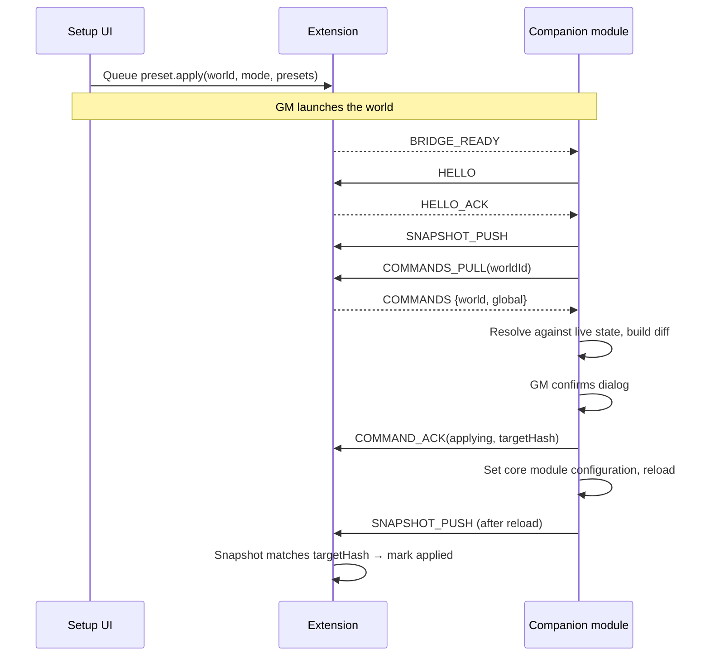

# PRD: Stagehand for Foundry VTT (working name)

| | |
|---|---|
| **Status** | Draft v0.5 |
| **Date** | 2026-11-04 |
| **Target** | Foundry VTT V13 and V14 at launch; V15 when released |
| **Deliverables** | Browser extension + companion module |
| **Out of scope (for now)** | Server-side companion |

---

## 1. Summary

Admins can't organise the modules they already have. The Add-on Modules tab on the Setup screen is one flat list. Every existing management tool (Big Bad Module Manager, Module Profiles, Sephral's Module Loadouts, Module Management+) runs inside a single world and only sees that world's active list.

Stagehand adds a structured, cross-world layer to the Setup screen. It offers folders, tags, smart groups, notes, author views, a per-world view of active modules, and presets that can **replace, add to, or remove from** a world's module set.

Modules can't run on the Setup screen, so the product has two parts:

- A **browser extension** that enhances the Setup page and holds the library and pending commands.
- A **companion module** that runs inside each world. It reports the world's state to the extension and applies queued changes on launch.

## 2. Problem

- Admins with 100+ installed packages can't group, tag, annotate or filter them in any useful way on the Setup screen.
- There is no way to see, from Setup, which modules each world uses. So it's unclear what can safely be removed.
- Existing preset tools replace a world's whole module list. Admins want to layer sets, for example "Core QoL" + "5e Combat" + "Campaign content".

## 3. Goals and non-goals

### Goals
1. Make the installed module library navigable and structured on the Setup screen.
2. Show each world's active modules from Setup.
3. Let admins build presets and apply them to a world in **replace**, **add** or **remove** mode, with a diff preview.
4. Never risk world data. All world changes go through Foundry's own client API, inside the world, after GM confirmation.

### Non-goals (this version)
- Server-side companion or direct database edits.
- Automatically propagating preset changes to multiple worlds.
- Presets that carry module **settings**. Module lists only.
- Installing new packages, or one-click install from websites. Core handles installation.
- Replacing in-world tools such as BBMM. Interoperability is a later goal.
- Author- or community-supplied metadata (tags, bundles, shared registry). Deferred until there's a trust model (section 10).

## 4. Users

| Persona | Needs |
|---|---|
| **Admin GM** (self-hosted, several worlds, large library) | Organise the library, see usage per world, prepare a world's module set before a session. |
| **Hosted GM** (Forge, Molten, etc.) | Same, where the host exposes the Setup screen (see Open Questions). The in-world part works regardless. |
| **World GM** (Gamemaster of a world, not the server admin) | Apply the admin's presets to their own world and manage that world's modules. Can't change the shared library (see 7.11). |
| **Translator / community** | Localise the UI. |

## 5. Landscape

| Tool | Where it runs | Gap this product fills |
|---|---|---|
| Big Bad Module Manager | In-world | No Setup presence. Presets replace the module list. |
| Sephral's Module Loadouts | In-world (world / installation scope) | No Setup presence or cross-world view. |
| Module Profiles | In-world | Same. |
| Module Management+ | In-world | Appears unmaintained (last verified V11). |
| Core V14 installer | Setup | Improved install and update flow and categories. No organisation of installed packages. |

Positioning: **library-level organisation at Setup, plus additive presets.** This complements in-world tools rather than replacing them.

## 6. Solution overview

```
┌────────────────────────────── Browser ──────────────────────────────┐
│                                                                     │
│  Setup page (/setup)              Game page (/game)                 │
│  ┌──────────────────────┐         ┌──────────────────────────────┐  │
│  │ Setup UI             │         │ Bridge content script        │  │
│  │ (content script)     │         │   ⇅ window.postMessage       │  │
│  └─────────┬────────────┘         │ Companion module (page JS)   │  │
│            │                      └──────────────┬───────────────┘  │
│            └──────────┐            ┌─────────────┘                  │
│                 ┌─────▼────────────▼─────┐                          │
│                 │ Extension background   │  library, snapshots,     │
│                 │ (service worker)       │  command queue           │
│                 └────────────────────────┘                          │
└─────────────────────────────────────────────────────────────────────┘
```

- **Extension background:** source of truth for the library (folders, tags, notes, presets), world snapshots and pending commands. Data is namespaced per server.
- **Setup UI:** content script injected into registered servers' Setup page. It reads installed-package data and renders the organisation layer.
- **Bridge:** content script on the game page. It relays messages between the companion module and the background. The bridge contains no Foundry logic.
- **Companion module:** owns all Foundry-side logic. It sends a snapshot of the world, pulls pending commands, checks dependencies and conflicts, gets GM confirmation and applies changes through core settings.

**Design decision:** the extension never calls Foundry APIs itself. All world mutations live in the listed module. That keeps the logic transparent, reviewable and versioned with Foundry compatibility.

### Version adapters
Foundry's Setup page and APIs differ between generations (V13, V14, V15) and sometimes between builds of one generation. The extension is split into two layers:

- **Version-independent core:** library, storage, UI components, protocol and dependency resolver.
- **Setup adapters:** one per supported version range, behind a fixed interface. The interface covers detecting the version, reading installed packages, reading worlds, mounting the UI and watching for re-renders.

On each Setup page load, the extension detects the core version and picks the adapter for that range. One extension build supports every version in the support window. Users who don't upgrade Foundry are never stuck on an old extension, and extension updates never require a Foundry upgrade.

Each server is handled independently, so one browser can manage a V13 server and a V14 server side by side.

## 7. Features and requirements

Priority: **P0** = MVP, **P1** = next release, **P2** = later.

### 7.1 Server registration (extension)
| ID | Requirement | P |
|---|---|---|
| R-1 | Admin adds a server by origin (e.g. `http://localhost:30000`). The extension requests host permission for that origin only and registers content scripts dynamically. | P0 |
| R-2 | No `<all_urls>` permission. | P0 |
| R-3 | Server aliases: several origins can point to one library (e.g. LAN IP and domain). | P1 |
| R-4 | **Remote config (data only):** fragile Setup-page selectors and per-core-version feature flags load from a versioned JSON file in the project repo, with a bundled fallback. This lets us fix breakage after a Foundry release without waiting for store review. Never remote code. | P0 |
| R-5 | **Minimal permissions:** `storage`, `scripting`, `activeTab` (the settings panel offers the Foundry server you are on, owner 2026-11-07) and per-server optional host permissions only. | P0 |

### 7.2 Setup screen organisation
| ID | Requirement | P |
|---|---|---|
| S-1 | **Folders:** create, rename, colour, reorder and collapse folders. Drag modules into folders. Each module is in at most one folder. | P0 |
| S-2 | **Nested folders** (max depth 2). | P1 |
| S-3 | **Tags:** many tags per module, with colours. Multi-tag filter with AND/OR. | P0 |
| S-4 | **Search** across title, id, author, tags and notes. | P0 |
| S-5 | **Saved views:** named filter combinations (e.g. "5e combat"). | P1 |
| S-6 | **Notes per module:** free text (e.g. "installed for Strahd", "conflicts with X"). | P0 |
| S-7 | **Author filter.** | P0 |
| S-8 | Toggle between the original core list and the organised view at any time. | P0 |
| S-9 | Bulk actions per folder: update, lock, uninstall (with confirmation). | P2 |

### 7.3 Smart groups (automatic, read-only)
| ID | Group | Rule | P |
|---|---|---|---|
| G-1 | Libraries | Manifest `library: true` | P0 |
| G-2 | Content packs | Has `packs`; no `esmodules`, `scripts` or `styles` | P0 |
| G-3 | By system | `relationships.systems` | P0 |
| G-4 | By author | Author identity (see 7.6) | P0 |
| G-5 | Not verified for this core version | `compatibility.verified` below the running core | P0 |
| G-6 | Recently updated | Installed version changed within N days (tracked by the extension) | P1 |
| G-7 | Unused | Active in 0 known worlds (from snapshots) | P1 |
| G-8 | Recommended, not installed | Union of installed modules' `relationships.recommends` that are not installed | P1 |

### 7.4 Worlds view
| ID | Requirement | P |
|---|---|---|
| W-1 | List worlds with their last snapshot: active modules, system, core version and **snapshot date**. | P0 |
| W-2 | Status per world: "companion not enabled", "snapshot stale", "pending changes (n)". | P0 |
| W-3 | "Used in N worlds" badge on each module. | P1 |
| W-4 | Drift view: which of a world's modules come from which presets, and which are unaccounted for. | P2 |

### 7.5 Presets (layers) and apply modes
| ID | Requirement | P |
|---|---|---|
| P-1 | Create a preset from a selection, a folder, a tag filter or a world snapshot. | P0 |
| P-2 | A preset is a named list of module ids, with an optional description. | P0 |
| P-3 | Apply one or more presets to a world in **Replace**, **Add** or **Remove** mode. | P0 |
| P-4 | **Diff preview** before queuing: added, removed, missing (not installed), dependency additions, conflicts, incompatible. | P0 |
| P-5 | Queued changes appear on the world card and can be cancelled before launch. | P0 |
| P-6 | Several queued commands for one world combine into **one** diff and **one** reload. | P0 |
| P-7 | Import and export individual presets as JSON (shareable "layers"). | P1 |

### 7.6 Authors
Built only from the standard manifest `authors` field. No new author-supplied metadata (see section 10).

| ID | Requirement | P |
|---|---|---|
| A-1 | **Author identity:** key by the first author's `url`, then `discord`, then normalised `name`. Admins can merge author entries that refer to the same person. | P1 |
| A-2 | **Author page:** all installed modules by that author, with links (website, Discord, bugs). | P1 |
| A-3 | Author page lists the author's other listed packages that aren't installed (requires the package index). | P2 |

### 7.7 Data portability and sync
| ID | Requirement | P |
|---|---|---|
| D-1 | Export and import the whole library as versioned JSON. | P0 |
| D-2 | Every preset, folder and tag set carries a `revision`. A save based on an old revision is rejected and goes to a merge prompt, never silently overwritten. | P0 |
| D-3 | **Server file sync from Setup** (built 2026-11-10, docs/LIBRARY-SYNC-PLAN.md): the admin's Setup page keeps the library in `Data/stagehand/library.json` with Foundry's own upload (no companion needed) and merges it with each device's copy, so the library follows the admin across devices. Only an admin-verified Setup (PR-1) writes it. World GMs could later read the published presets from it (PR-5). | P1 |
| D-4 | ~~Warn that files in the user data folder are reachable by URL; option to exclude notes from server sync.~~ Dropped by the owner (2026-11-10): module notes are not expected to hold anything private, and module manifests and `world.json` are public the same way. | — |

### 7.8 Companion module (in-world)
| ID | Requirement | P |
|---|---|---|
| C-1 | Run only for users with the full Gamemaster role (not Assistant GM). Detect the extension through a handshake. If none is found, use the published library if there is one (PR-5); otherwise stay idle (one-time optional notice). | P0 |
| C-2 | Push a world snapshot on every GM launch. | P0 |
| C-3 | Pull pending **world** commands and **global** data on launch (protocol in section 8). | P0 |
| C-4 | Recompute the diff against the **live** state, not the stale snapshot. Show a confirmation dialog. On confirm, apply, acknowledge and reload once. | P0 |
| C-5 | Never disable itself, even in Replace mode. | P0 |
| C-6 | Mirror core's checks: required dependencies, conflicts, version compatibility, system restrictions. | P0 |
| C-7 | Optional: show folders and tags in core's Manage Modules dialog (read-only). | P2 |

### 7.9 Localisation
| ID | Requirement | P |
|---|---|---|
| L-1 | All UI strings in i18n files from day one, for both extension and module. | P0 |
| L-2 | The Setup UI follows the server's configured language where it can be detected, falling back to the browser language. | P1 |
| L-3 | Ship English plus at least one community language at launch (e.g. Russian). | P1 |

### 7.10 Multi-version support
| ID | Requirement | P |
|---|---|---|
| V-1 | Detect the Foundry core version (generation and build) on Setup and game pages, per server. | P0 |
| V-2 | Pick the adapter by version range: exact range match first, then the closest older adapter in the same generation (flagged "untested build"), then safe mode. | P0 |
| V-3 | **Safe mode** for unknown versions: read-only organisation view if package data can be read, no actions that change anything, and a clear "unsupported version" notice. The core list stays available. Never break the Setup page. | P0 |
| V-4 | **Support window:** the current stable generation and the previous one (V13 and V14 at launch). Dropping a generation is announced at least one release ahead, in the changelog and the UI. | P0 |
| V-5 | The remote config (R-4) is keyed by version range, so support for new minor builds can be added without a store release. | P0 |
| V-6 | **Companion module:** one codebase, with feature detection for API differences. The manifest's `compatibility.minimum` is the oldest supported generation. Split into separate releases per generation only if detection becomes unworkable; the package listing then serves each user the newest release compatible with their core version. | P0 |
| V-7 | Library and preset data are version-independent. Version-specific facts (core version, module versions) live only in snapshots. Applying a preset checks compatibility against **that world's** core version. | P0 |
| V-8 | Automated test matrix against every supported generation and the latest Foundry testing build. | P1 |

### 7.11 Roles and permissions
Foundry has no flag that tells a page "this user is the server admin". It only shows the Setup screen after the Administrator password has been entered, and inside a world it only knows world roles. The product therefore has two tiers:

- **Admin:** a browser that has reached an authenticated Setup page for this server. Owns the global library.
- **World GM:** a user with the full Gamemaster role in a world. Can only act on that world.

| Action | Admin | World GM | Assistant GM, players |
|---|---|---|---|
| Edit folders, tags, notes, saved views, presets | Yes | No (read-only) | No |
| Queue changes for any world from Setup | Yes | No | No |
| Publish the library to the server | Yes | No | No |
| Apply presets to their own world, in-world | Yes | Yes | No |
| Change their own world's module list and world-scoped data | Yes | Yes | No |

| ID | Requirement | P |
|---|---|---|
| PR-1 | **Admin verification:** the extension marks a server "admin-verified" in this browser only after it has seen an authenticated Setup page for that server, and records when. | P0 |
| PR-2 | Global library data (folders, tags, notes, saved views, presets) can only be edited from an admin-verified browser. Everyone else gets a read-only view. | P0 |
| PR-3 | World commands can only be created from the Setup UI, i.e. by an admin. | P0 |
| PR-4 | In-world actions require the full Gamemaster role. Check the exact role, not a general "is GM" check that may include Assistant GMs. | P0 |
| PR-5 | **World GMs without the extension:** the module reads the published `library.json` (D-3) and offers "Apply presets" for the current world only, using the same diff and confirmation flow (8.5). | P1 |
| PR-6 | **World-scoped data** (for example, which presets this world follows) is stored in that world's own settings and is editable by its GM. It never changes the global library. | P1 |
| PR-7 | The bridge and module reject any message that changes global data (library writes, `library.push`) unless the server is admin-verified in this browser. | P0 |
| PR-8 | **Tamper detection:** the admin's extension keeps the revision and hash of the last library it published. If the server copy differs, Setup warns and offers to restore it. | P1 |
| PR-9 | Optional expiry: require a fresh Setup visit after N days before global edits are allowed again. | P2 |

**Limits.** These rules decide what the tool offers, not what Foundry allows. A full GM can already change their world's modules through core, and GMs can usually upload files, so a GM could replace `library.json` outside the tool (PR-8 detects that). If the server has no Administrator password, Foundry opens straight to Setup and anyone who can reach the server counts as an admin.

## 8. Module ↔ extension protocol

### 8.1 Transport
- The companion module (page JavaScript) and the bridge content script talk through `window.postMessage(msg, location.origin)`.
- The bridge relays to the background via `runtime.sendMessage`.
- `externally_connectable` is **not** used. It needs Foundry origins listed in the extension manifest in advance, and Firefox support differs.

### 8.2 Envelope
```json
{
  "ns": "stagehand",
  "v": 1,
  "type": "COMMANDS_PULL",
  "requestId": "b6f1…",
  "payload": {}
}
```

### 8.3 Messages
| Type | Direction | Payload |
|---|---|---|
| `BRIDGE_READY` | bridge → module | `{ extensionVersion, protocol: [1] }` |
| `HELLO` | module → ext | `{ moduleVersion, protocol: [1], worldId, coreVersion }` |
| `HELLO_ACK` | ext → module | `{ protocol: 1, serverId, features: [...] }` |
| `SNAPSHOT_PUSH` | module → ext | World snapshot (section 9) |
| `COMMANDS_PULL` | module → ext | `{ worldId }` |
| `COMMANDS` | ext → module | `{ world: Command[], global: Command[] }` |
| `COMMAND_ACK` | module → ext | `{ id, status: "applying" \| "applied" \| "failed" \| "declined", targetHash?, error? }` |
| `LIBRARY_PULL` | module → ext | `{}`. Used for server sync and the optional in-world view. |
| `LIBRARY` | ext → module | Library document |
| `LIBRARY_SYNC_RESULT` | module → ext | `{ status: "written" \| "conflict", serverRevision }` |

**Command scopes**
- **World:** `preset.apply` (P0) and `snapshot.refresh` (P0).
- **Global:** `library.push` (P1, write `library.json` to the server) and `library.pullServer` (P1, read the server copy back for merge).

### 8.4 Launch sequence



Two-phase acknowledgement: the command is only marked **applied** once the post-reload snapshot matches the target. A crash or failed reload leaves it **applying**, and the extension retries or asks on the next launch.

### 8.5 Apply algorithm (companion module)
1. `current` = live active modules.
2. `preset` = union of the command's preset module ids, skipping ids that aren't installed (reported as **missing**).
3. Target:
   - **Replace:** `preset ∪ {companion}`
   - **Add:** `current ∪ preset`
   - **Remove:** `current − preset`, never removing the companion
4. **Dependencies:** recursively add `relationships.requires` for every target module. If a requirement isn't installed, block that module and report it.
5. **Remove safety:** if a removed module is required by a module that stays, warn. The GM chooses between removing dependents too or cancelling.
6. **Conflicts:** flag pairs declared in `relationships.conflicts`, respecting version ranges. The GM must confirm explicitly.
7. **Compatibility and system:** exclude modules that core would refuse (compatibility range, other system) and report them.
8. Show the diff. On confirm, write core's module configuration setting and reload once.

### 8.6 Security rules
- The bridge accepts only messages where `event.source === window`, `event.origin === location.origin` and `ns` matches.
- The bridge only serves data for the current server's `serverId`. It never returns other servers' data.
- Messages carry data only. Nothing from a message is ever executed.
- The module initiates only when the current user has the full Gamemaster role. It ignores unsolicited responses (unknown `requestId`).
- The bridge stays off for servers that aren't admin-verified in this browser (PR-1), and rejects global-data writes accordingly (PR-7).
- Other in-page scripts (other modules) could message the bridge too. This is accepted, because in-page code already has full GM authority. Exposure is limited to this server's library and queue.
- The extension never reads, stores or fills the admin password or licence fields.

### 8.7 Protocol versioning
- `HELLO` and `HELLO_ACK` negotiate the protocol version: both sides list the versions they support and use the highest one in common.
- A world on an older Foundry may keep an older companion module for a long time. The extension keeps supporting every protocol version used by any module release still inside the support window.
- If there's no version in common, the module stays idle and says which side needs updating. The extension marks that world "companion outdated" on Setup.
- Changes are additive by default, and receivers ignore unknown fields. A breaking change requires a new protocol version.

## 9. Data model (per server)

```jsonc
{
  "schemaVersion": 1,
  "serverId": "http://localhost:30000",
  "revision": 42,
  "folders":  [{ "id": "f1", "name": "Lighting & FX", "color": "#e0a", "parentId": null, "order": 0, "revision": 3 }],
  "tags":     [{ "id": "t1", "name": "combat", "color": "#3a7" }],
  "modules":  { "<moduleId>": { "folderId": "f1", "tags": ["t1"], "note": "…", "firstSeenVersion": "2.1.0" } },
  "views":    [{ "id": "v1", "name": "5e combat", "filter": { "tags": ["t1"], "op": "and", "systems": ["dnd5e"] } }],
  "presets":  [{ "id": "p1", "name": "Core QoL", "description": "", "modules": ["a", "b"], "source": "user", "revision": 5 }]
}
```

**World snapshot**
```jsonc
{
  "worldId": "strahd", "title": "Curse of Strahd",
  "system": { "id": "dnd5e", "version": "5.1.0" },
  "coreVersion": "14.368",
  "active": [{ "id": "a", "version": "1.2.0" }],
  "companionVersion": "0.1.0",
  "takenAt": "2026-11-04T22:40:00Z"
}
```

**Command**
```jsonc
{
  "id": "c1", "scope": "world", "worldId": "strahd",
  "type": "preset.apply",
  "payload": { "mode": "add", "presetIds": ["p1"] },
  "createdAt": "…", "baseSnapshotAt": "…",
  "status": "pending"            // pending | applying | applied | failed | declined | cancelled
}
```

## 10. Later: author and community metadata (out of scope)

Letting authors tag their modules and define bundles in their manifests would be useful. It's deferred because there's no trust model yet.

**The problem**
- Any manifest can claim anything. A module could add itself to another author's bundle, claim another author's identity, or use tags to push itself into groups where it doesn't belong.
- A shared community registry moves the same problem up a level: someone has to review every contribution.

**Directions to explore later**
- **Two-way membership:** a module only counts as part of a bundle if the bundle's owner lists it *and* the module itself declares the bundle.
- **Ownership by publisher account:** only packages published by the same foundryvtt.com account can form a bundle. This depends on data from the package listing.
- **Suggestions, not groups:** show author data only as a labelled suggestion ("Suggested by X") that the admin can accept into their own folders, never as an automatic group.
- **Curated registry:** maintainers review every pull request, at an ongoing cost.

Until then, organisation comes only from the admin (folders, tags, notes, presets) and from standard manifest fields (`authors`, `library`, `packs`, `relationships`).

## 11. UX notes

- **Setup, Add-on Modules tab:** a sidebar with folders, smart groups, tags, authors and saved views. The main list is grouped and collapsible. The core list stays one click away (S-8).
- **Module row:** folder chip, tags, note icon, "used in N worlds", author link.
- **Worlds tab:** world cards show snapshot age, active count and a pending-changes badge, plus an "Apply presets…" action that opens the mode picker and diff.
- **In-world dialog on launch:** a short diff with added, removed and warnings, and the buttons "Apply & reload", "Not now" and "Discard".
- **Empty states:** explain that the companion must be enabled once per world, and that snapshots appear after the next launch.

## 12. Technical constraints and risks

| Risk | Impact | Mitigation |
|---|---|---|
| Setup page internals are undocumented and change between versions | Setup UI breaks on updates | Read package data, not markup, where possible. Version adapters (section 6), safe mode (V-3), version-keyed remote config (V-5), test matrix (V-8). |
| Extension and module versions drift apart across worlds and servers | Broken handshake for some worlds | Protocol negotiation and long protocol support (8.7). Visible "companion outdated" status. |
| The Foundry desktop app (Electron) has no browser extensions | Setup features unavailable there | Document opening the server in Chrome or Firefox. The in-world part needs the extension in that browser too. |
| Hosted services may replace or restrict the Setup screen | Reduced reach | Verify per host. The in-world part still works. |
| Setting module configuration directly skips core's dependency prompts | Broken worlds | Mirror core's checks (8.5). Always show a diff. Require GM confirmation. |
| Browser storage is per device | Lost organisation | Server file sync (D-3, built); export and import (D-1) stay as a backup. |
| User data folder files are URL-readable | Notes readable by anyone with the path | Accepted by the owner (D-4 dropped); the file holds no secrets. |
| GMs can upload files and change world settings outside the tool | Published library overwritten by a non-admin | Admin's extension is the master copy; tamper detection and restore (PR-8). |
| Server has no Administrator password | Anyone who can reach Setup counts as admin | Onboarding notice and docs recommending an admin password, as Foundry itself does. |
| Store review of host permissions | Delayed listing | Per-origin optional permissions only, with clear justifications. |
| Store review delays hotfixes (Chrome usually takes days, sometimes weeks) | Setup UI broken for days after a Foundry release | Remote selector config (R-4). Test against Foundry testing builds before each stable release. |
| Exact V14 API for module configuration and package data | Spike needed | Milestone M0. |

## 13. Distribution and policy

- **Module:** official Foundry package listing. It must follow Foundry's AI content policy: code may be AI-assisted if the authors understand and maintain it, but the listing description and other user-facing text must be human-written.
- **Extension:** Chrome Web Store (covers Chrome, Edge, Brave and other Chromium browsers) and Firefox Add-ons (AMO). Open source.
- Licence: an open-source licence of choice, plus the Foundry Limited License for package development (module).

### Store checklist
- **Chrome Web Store:** one-time US$5 developer registration. Use a shared team email, because the account email can't be changed later. Fill in the privacy practices section (all data stays local and nothing is transmitted). Read the definition before answering the EU trader declaration, since it affects which contact details are shown publicly.
- **Firefox AMO:** free account. Declare no data collection using Firefox's built-in data collection consent. Ship unminified code, or attach the source. Check Mozilla's updated add-on policies (effective 1 December 2026) before submitting.
- **Review timing:** Chrome review usually takes a few days and can take weeks, so plan launches and hotfixes around it. AMO lists after automated checks, with a possible human review later.
- **Pre-release testing:** give testers unpacked builds (Chrome) and unlisted, self-distributed builds signed through AMO (Firefox) before submitting to the stores.

## 14. Success metrics (targets to be set)

- Extension weekly active users (Chrome and Firefox stores).
- Companion module adoption: share of extension users with at least one world snapshot.
- Presets applied per active user per month. Share applied in Add mode versus Replace.
- Qualitative: Foundry Discord and r/FoundryVTT feedback, and issue volume per core release.

## 15. Milestones

| Milestone | Scope |
|---|---|
| **M0 Spike** | Confirm on V13 and V14 (and note the differences for the adapter interface): injecting into Setup, reading package data, the postMessage bridge, and writing module configuration plus reload from the module. Confirm dynamic content-script registration with per-server permissions in both Chrome and Firefox. Register store accounts. |
| **M1 MVP (P0)** | Server registration, folders, tags, notes, search, author filter, smart groups G-1 to G-5, worlds view, presets with three modes and diff, companion apply flow, export and import, i18n scaffolding, admin verification and role checks (PR-1 to PR-4, PR-7). |
| **M2** | Author pages, "used in N worlds", recommended-not-installed, preset sharing, server file sync, in-world apply for World GMs (PR-5, PR-6), tamper detection (PR-8), nested folders, saved views. |
| **M3** | Bulk folder actions, drift view, in-world read-only view, BBMM interoperability. |
| **Later** | Author and community metadata, once a trust model exists (section 10). |
| **Ongoing** | Run the test matrix on every supported generation and each Foundry testing build. Update the remote config before each stable release. |

## 16. Open questions

1. Final product name.
2. Ship Chromium-only first, or Chrome and Firefox together?
3. How should pending commands behave when a world is renamed, duplicated or deleted?
4. How does Setup behave on the Forge, Molten and other hosts?
5. Should "Not now" on the launch dialog keep commands pending indefinitely, or expire them?
6. Should snapshots also record module versions, to flag "updated since last launch"?
7. Is BBMM's author open to a shared preset and folder format?
8. Is two generations the right support window, or should V12 be included for long-running campaigns?
9. The test matrix needs real Foundry instances, with a licence per instance. How will these be hosted for automated tests?

## 17. Future: server companion (out of scope)

A self-hosted companion process could later implement the same command contract. It would apply presets instantly while a world is stopped, using Foundry's LevelDB tooling with a backup first. It would also store the library privately outside the user data folder and enforce revisions on the server side. The protocol in section 8 is designed so the extension can switch between it and the in-world module.
